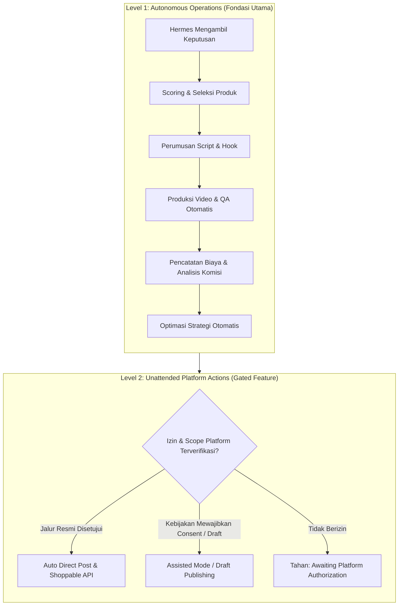

# 01. Visi, Masalah & Target Pengguna
**Navigasi:** [← Index Utama](./README.md) | [Berikutnya: Arsitektur Sistem & Orkestrasi Hermes →](./02_architecture_and_hermes_orchestration.md)

---

## 1. Ringkasan Eksekutif
 
**Velora AI** (*The Autonomous Fashion Affiliate Engine*) adalah platform bisnis otonom yang dirancang untuk mengoperasikan seluruh rantai nilai bisnis TikTok Shop Affiliate di pasar Indonesia secara mandiri dan *data-driven*. Sistem ini dioperasikan oleh **Hermes Agent** sebagai AI Operator utama yang mengambil keputusan strategis, didukung oleh modul riset produk cerdas, engine produksi konten multimedia (*script, visual generation, voice-over, dan FFmpeg assembly*), serta alur *Assisted Publishing* yang patuh pada ketentuan platform TikTok.
 
Prinsip utama yang mendasari produk ini adalah: **sistem dioptimalkan untuk menghasilkan komisi bersih yang berkelanjutan (*net operating profit*), bukan sekadar memperbanyak jumlah video atau mengejar *views* semu.**

---

## 2. Latar Belakang dan Masalah Nyata

Operasional bisnis affiliate fashion tradisional di TikTok Shop menghadapi hambatan skalabilitas yang signifikan jika dijalankan secara manual:
1. **Inefisiensi Riset Produk:** Pemilihan produk sering kali mengandalkan intuisi atau tren sesaat tanpa memperhitungkan stabilitas komisi, reputasi seller, ketersediaan stok, dan histori konversi.
2. **Kelelahan Produksi Konten (*Creative Burnout*):** Menghasilkan 3–5 video per hari dengan variasi script, visual, dan hook yang relevan sangat sulit dipertahankan secara manual.
3. **Halusinasi Visual AI (*Product Inaccuracy*):** Penggunaan AI generatif sering mengubah detail produk penting (kerah, bahan, warna, logo, jahitan), sehingga mengecewakan penonton dan merusak reputasi akun.
4. **Masalah Integritas Tautan (*Anchor Failure*):** Video yang viral tidak menghasilkan rupiah jika penautan produk ("keranjang kuning") gagal terpasang atau terputus karena masalah teknis/izin.
5. **Kesenjangan Views vs Komisi:** Konten dengan jutaan tayangan belum tentu menghasilkan penjualan jika target audiens tidak memiliki *buying intent* atau visual tidak membangun kepercayaan.
6. **Kurangnya Rekonsiliasi Finansial:** Biaya generasi API, komputasi VPS, dan biaya operasional sering tidak dicatat, sehingga bisnis tampak menghasilkan omset namun secara riil mengalami kerugian (*negative net ROI*).

Otomatisasi konvensional (seperti skrip cron sederhana atau alur n8n kaku) hanya memindahkan pekerjaan manual menjadi alur otomatis tanpa kemampuan adaptasi atau evaluasi kualitatif. Proyek ini hadir untuk menghadirkan **agen cerdas yang mampu mengambil keputusan bisnis berbasis data**.

---

## 3. Visi Produk: The Autonomous Operational Loop

Visi utama proyek ini adalah membangun *self-operating affiliate business* yang berjalan secara berkesinambungan melalui siklus tertutup (*closed-loop*):

$$\text{Discover} \longrightarrow \text{Evaluate} \longrightarrow \text{Strategize} \longrightarrow \text{Produce} \longrightarrow \text{Validate} \longrightarrow \text{Publish} \longrightarrow \text{Measure} \longrightarrow \text{Learn} \longrightarrow \text{Repeat}$$

1. **Discover:** Menemukan kandidat produk dari katalog resmi TikTok Shop.
2. **Evaluate:** Menilai produk dengan scoring multidimensi dan memeriksa kelayakan hukum/izin.
3. **Strategize:** Merancang sudut pandang konten (*angle*), pilar format, hook persuasif, dan CTA.
4. **Produce:** Memproduksi visual berbasis AI dan merakit video vertikal dengan audio/subtitle.
5. **Validate:** Menjalankan QA teknis dan verifikasi kesesuaian fisik produk terhadap barang asli.
6. **Publish:** Menerbitkan video melalui adapter resmi yang terotorisasi.
7. **Measure:** Memverifikasi penautan keranjang kuning dan mengumpulkan data analitik serta pesanan.
8. **Learn:** Menghitung laba operasional bersih dan memperbarui bobot scoring untuk iterasi berikutnya.

---

## 4. Dua Tingkat Otomatisasi: Mengurai Blind Spot "Full Automation"

Salah satu *blind spot* terbesar dalam proyek otomatisasi TikTok adalah mencampuradukkan dua definisi otomatisasi yang berbeda:

### Level 1 — Autonomous Operations (Target Inti Sistem)
Hermes secara independen menentukan tugas, menyeleksi produk, membuat brief, memicu pembuatan video, memverifikasi kepatuhan kualitas, mengelola antrean, memantau error, serta mengkalkulasi profitabilitas tanpa memerlukan instruksi manusia pada setiap putaran kerja harian. **Level ini sepenuhnya berada di bawah kendali kita dan menjadi fondasi utama sistem.**

### Level 2 — Unattended Platform Actions & Realita Kebijakan TikTok
Kemampuan sistem untuk menyelesaikan tindakan pada platform pihak ketiga (TikTok Shop) 100% tanpa campur tangan manusia—khususnya penerbitan video langsung ke publik (*Direct Post*) dan penautan keranjang kuning (*Shoppable Video Anchor*).

> [!IMPORTANT]
> **Realita Kebijakan Pengembang TikTok:**  
> Dokumentasi resmi TikTok Developer Guidelines secara eksplisit menyatakan bahwa aplikasi Direct Post **wajib memberikan kontrol kepada pengguna/kreator, menampilkan pratinjau konten, menyediakan pengaturan posting, dan meminta persetujuan pengguna sebelum konten dikirim ke platform.** Panduan tersebut secara tegas **menolak aplikasi yang semata-mata menjadi utilitas pengunggah konten (*upload utility*) ke akun yang dikelola oleh pembuat aplikasi itu sendiri.**  
> 
> Oleh karena itu, arsitektur sistem menetapkan 3 jalur penerbitan bertahap (*Tiered Publishing Pathways*):
> - **Jalur 1 — TikTok Shop Creator Shoppable Video API (v202607):** Jalur partner resmi yang dirancang khusus untuk konten e-commerce dengan otorisasi affiliate.
> - **Jalur 2 — Assisted / Draft Publishing Mode (Rekomendasi Default MVP):** Hermes secara 100% otonom memproduksi video, menyusun brief, caption, hashtag, dan menyiapkan file di antrean draft; kreator cukup melakukan konfirmasi 1-klik di aplikasi TikTok untuk menautkan keranjang kuning resmi.
> - **Jalur 3 — Content Posting API dengan Consent UI:** Hanya diaktifkan jika aplikasi developer berhasil diajukan dan disetujui auditnya dengan menyertakan antarmuka pratinjau yang memenuhi standar platform.

---

## 5. Target Pengguna & Batasan Batas MVP

### Primary User
Pemilik bisnis solopreneur atau tim affiliate yang ingin mengoperasikan kanal TikTok fashion komersial dengan efisiensi maksimal dan intervensi manual minimal.

### Karakteristik Akun & Lingkup MVP
- **Pasar Fokus:** TikTok Shop Indonesia (mata uang IDR, tren fashion lokal).
- **Jenis Akun:** Satu akun kreator affiliate baru yang diautentikasi secara sah.
- **Gaya Konten:** *Faceless AI Video* (video estetika mode tanpa keharusan kreator tampil di depan kamera).
- **Infrastruktur:** 1 unit Virtual Private Server (VPS) berspesifikasi memadai dengan Docker (diuji di lokal terlebih dahulu).
- **Orchestrator:** Hermes Agent sebagai entitas AI tunggal.

### Batasan Eksplisit (Out of Scope untuk MVP)
- Multi-account management (pengelolaan puluhan akun secara paralel ditunda hingga MVP terbukti menghasilkan laba).
- Ekstensi ke platform lain (Shopee Video, Instagram Reels, YouTube Shorts).
- Otomasi kampanye iklan berbayar (TikTok Ads / Spark Ads).
- Otomasi siaran langsung (*Live Streaming AI*).
- Penggunaan teknik *browser bypassing* agresif yang melanggar ketentuan layanan platform.

---

**Langkah Selanjutnya:** Pelajari bagaimana Hermes mengoordinasikan seluruh sistem melalui antarmuka tools dan Adapter pada [02_architecture_and_hermes_orchestration.md](./02_architecture_and_hermes_orchestration.md).
