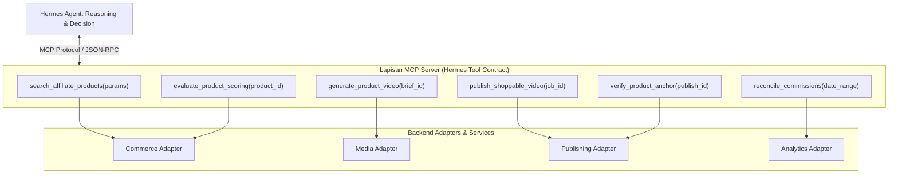
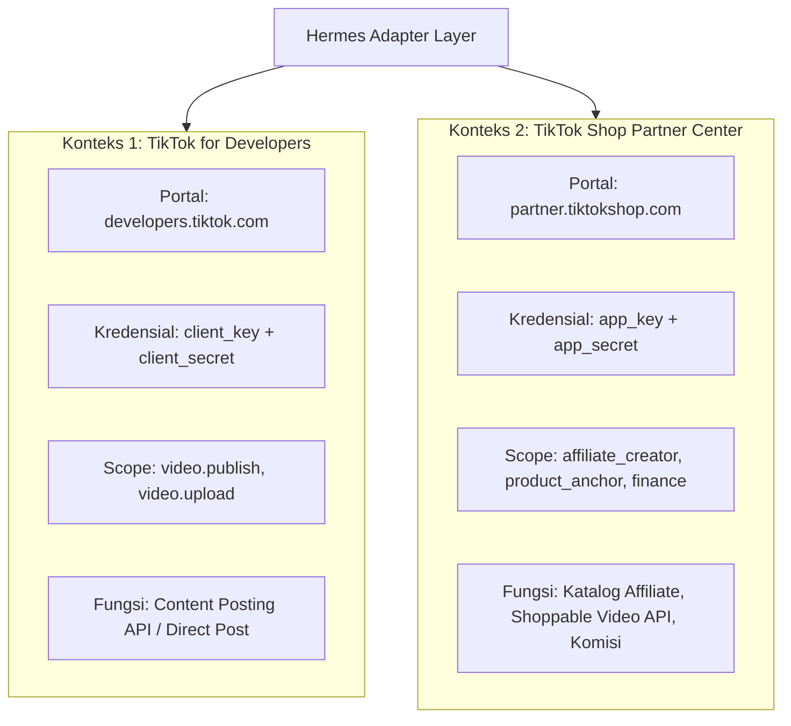

# 02. Arsitektur Sistem & Orkestrasi Hermes
**Navigasi:** [← 01. Visi & Target Pengguna](./01_executive_summary_and_vision.md) | [Index Utama](./README.md) | [Berikutnya: Feasibility POCs & Platform Gates →](./03_feasibility_pocs_and_evaluation_gates.md)

---

## 1. Hermes Agent sebagai Orchestrator Utama

Sistem ini menetapkan **Hermes Agent** sebagai satu-satunya *autonomous brain* yang memimpin seluruh siklus operasional bisnis. Hermes tidak hanya berfungsi sebagai asisten percakapan, melainkan sebagai *autonomous process runner* yang:

1. **Memiliki Perencanaan Otonom (*Reasoning & Decision Making*):** Menentukan produk apa yang layak diproduksi, menimbang trade-off antara komisi dan biaya generasi, serta memilih format konten terbaik berdasarkan histori performa.
2. **Mengelola Penjadwalan (*Hermes Native Cron*):** Mengatur siklus rutin harian (misal: riset produk pukul 06:00, produksi konten pukul 09:00, penerbitan bertahap pada *peak hours*, rekonsiliasi analitik pukul 23:00) menggunakan fitur *cron* bawaan Hermes.
3. **Mengeksekusi Pekerjaan via Tools & MCP:** Memanggil kemampuan teknis melalui antarmuka standar tool calling dan MCP (*Model Context Protocol*).
4. **Menganalisis Error & Self-Healing:** Mengidentifikasi kegagalan upstream, menerapkan kebijakan retry terukur (*exponential backoff*), dan mengubah status pekerjaan jika terjadi anomali permanen.

> [!IMPORTANT]
> **Kebijakan Tegas: Tanpa n8n.**  
> Proyek ini **sama sekali tidak menggunakan n8n**. Ketergantungan pada workflow engine eksternal seperti n8n dihilangkan sepenuhnya demi memusatkan seluruh *state machine*, logika bisnis, dan evaluasi adaptif di dalam Hermes Agent bersama database Supabase.

---

## 2. Posisi MCP (Model Context Protocol) dalam Sistem

Salah satu klarifikasi fundamental dalam arsitektur ini adalah memahami posisi MCP:

- **MCP bukan pengganti API TikTok atau layanan pihak ketiga.**
- **MCP adalah lapisan antarmuka standar (*tool interface*) agar Hermes dapat memanfaatkan kapabilitas sistem secara terstruktur.**

Hermes tidak perlu mengetahui apakah di belakang suatu tool terdapat REST API resmi, skrip FFmpeg lokal, atau panggilan SDK khusus. Hermes hanya berkomunikasi dengan kontrak tool standar:



### Skema Kontrak Tool Hermes Utama

| Tool Name | Parameter Utama | Output yang Diharapkan | Tanggung Jawab Error Handling |
|:---|:---|:---|:---|
| `search_affiliate_products` | `category`, `min_commission_rate`, `price_range` | List produk dengan ID, harga, komisi, URL gambar, & seller rank | Validasi izin API & deteksi perubahan struktur katalog |
| `evaluate_product_scoring` | `product_id`, `scoring_version` | Rincian skor 6 dimensi, confidence score, rekomendasi approval | Penolakan data tidak lengkap (`needs_verification`) |
| `generate_product_video` | `brief_id`, `aspect_ratio`, `provider_preference` | File video lokal, durasi, status QA teknis, biaya komputasi | Penanganan session expiry & fallback provider |
| `publish_shoppable_video` | `video_id`, `product_id`, `caption`, `idempotency_key` | Status unggahan (`published` / `pending_review`), publish ID platform | Pencegahan duplikasi unggahan pasca timeout |
| `verify_product_anchor` | `publish_id`, `expected_product_id` | Status anchor (`anchor_verified` / `anchor_failed` / `manual_required`) | Deteksi pemutusan tautan keranjang kuning |
| `reconcile_commissions` | `start_date`, `end_date` | Laporan komisi terkonfirmasi, order lines, pembatalan, laba bersih | Perhitungan laba riil pasca pemotongan biaya produksi |

---

## 3. Pemisahan Konteks Otorisasi Dual-OAuth TikTok

Sistem membedakan dua konteks otorisasi platform TikTok yang memiliki portal, scope, dan tujuan berbeda:



- **Konteks 1 (Content Posting API):** Mengelola hak unggah video media. Token disimpan terpisah di tabel kredensial dengan scope posting video.
- **Konteks 2 (TikTok Shop Partner / Creator API):** Mengelola hak katalog toko affiliate, penautan produk shoppable, dan pelacakan transaksi komisi e-commerce.

---

## 4. Pola Adapter Modular & Kontrak Worker Lease Atomik

Layanan pendukung sistem dirancang dengan prinsip **keterpisahan tanggung jawab (*Separation of Concerns*)** dan transaksi pekerjaan yang aman (*concurrency-safe*).

### Kontrak Worker Lease Atomik (`production_jobs`)
Untuk mencegah perebutan pekerjaan antar-worker saat skalaritas ditingkatkan atau saat restart container terjadi, sistem menerapkan mekanisme penguncian (*lease lock*) berbasis waktu:

```sql
-- Contoh kueri klaim pekerjaan atomik oleh Media Worker:
UPDATE production_jobs
SET 
    locked_by = :worker_id,
    locked_at = NOW(),
    lease_expires_at = NOW() + INTERVAL '15 minutes',
    job_status = 'claimed'
WHERE id = (
    SELECT id FROM production_jobs
    WHERE job_status = 'queued'
       OR (job_status = 'claimed' AND lease_expires_at < NOW())
    ORDER BY created_at ASC
    LIMIT 1
    FOR UPDATE SKIP LOCKED
)
RETURNING *;
```

### Transisi Status Kanonis Pekerjaan Produksi:
$$\text{queued} \longrightarrow \text{claimed} \longrightarrow \text{generating\_visuals} \longrightarrow \text{assembling\_ffmpeg} \longrightarrow \text{qa\_running} \longrightarrow \text{completed} \mid \text{failed} \mid \text{dead\_letter}$$

- **Heartbeat Worker:** Selama proses rendering berlangsung, worker memperbarui `lease_expires_at` setiap 2 menit.
- **Auto-Recovery:** Jika worker crash di tengah jalan, lease akan kedaluwarsa secara otomatis dalam 15 menit dan job dapat diklaim ulang oleh worker berikutnya (hingga batas `max_retries = 3` sebelum masuk `dead_letter`).

---

## 5. Supabase sebagai Sumber Kebenaran Tunggal (*Single Source of Truth*)

Hermes Agent **dilarang keras mengandalkan riwayat chat atau memori context window untuk menyimpan status bisnis**. Context window bersifat mudah hilang (*ephemeral*) dan terbatas.

Seluruh data krusial disimpan secara persisten di Supabase (PostgreSQL):
- **Status Produk & Histori Scoring:** Mengetahui produk mana yang sedang diuji, ditolak, atau diprioritaskan.
- **State Machine Pekerjaan (*Job State*):** Setiap tahap pembuatan video dan posting tercatat dengan status eksplisit.
- **Audit Events:** Setiap keputusan penting (kenapa suatu produk dipilih, kenapa video ditolak QA) memiliki catatan audit (*audit log*).
- **Kredensial & Secrets:** Token OAuth disimpan terenkripsi dengan AES-256-GCM pada level aplikasi sebelum masuk ke tabel database.

---

## 6. Tool-First & Evidence-Based Execution

Hermes mengadopsi prinsip verifikasi ketat berbasis bukti (*evidence-based*):
- Hermes tidak diperbolehkan berasumsi bahwa sebuah video telah tayang hanya karena permintaan upload berhasil dikirim. **Harus ada Post ID / Publish ID dan status konfirmasi resmi dari platform.**
- Hermes tidak diperbolehkan mencatat bahwa komisi telah masuk hanya berdasarkan kalkulasi estimasi pesanan. **Harus ada rekonsiliasi data komisi terkonfirmasi dari platform.**
- Jika respon jaringan mengalami timeout atau status tidak jelas, Hermes memicu proses rekonsiliasi status (*status reconciliation*), bukan melakukan upload ulang sembarangan.

---

**Langkah Selanjutnya:** Pahami 4 pengujian teknis wajib (*Feasibility POCs*) yang harus diselesaikan sebelum membangun pipeline penuh pada [03_feasibility_pocs_and_evaluation_gates.md](./03_feasibility_pocs_and_evaluation_gates.md).
