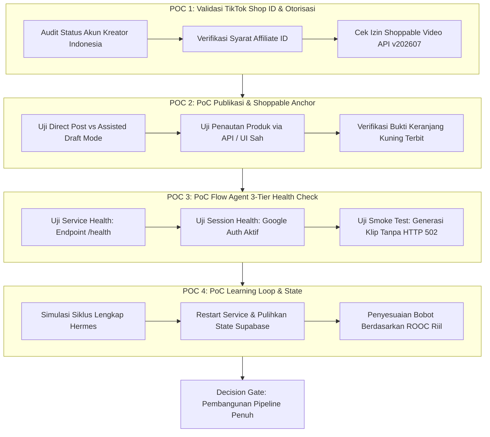
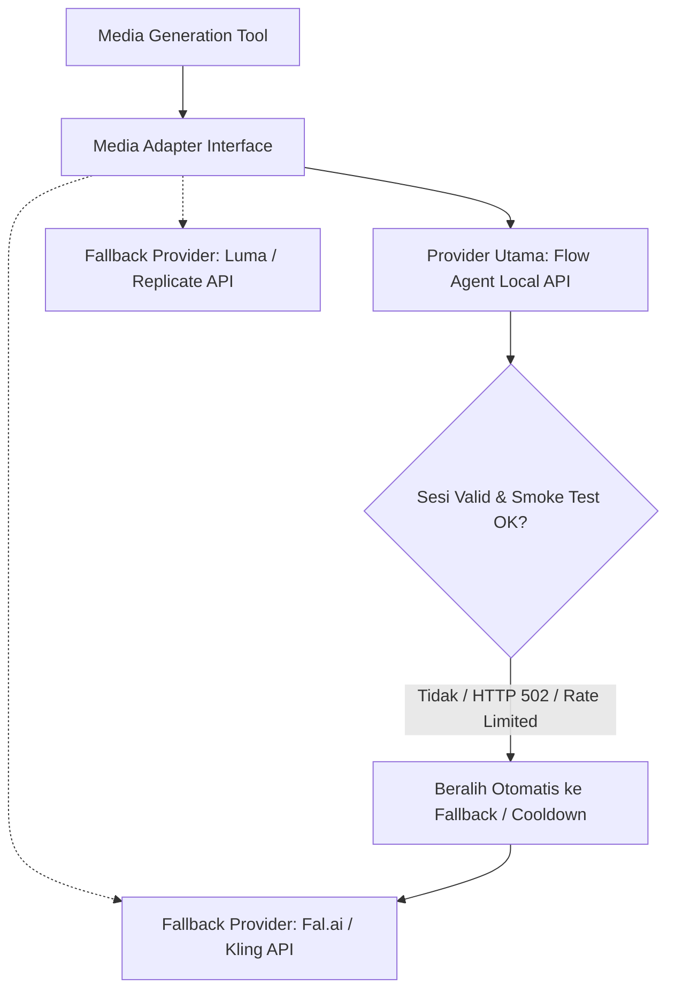

# 03. Feasibility POCs & Platform Evaluation Gates
**Navigasi:** [← 02. Arsitektur Sistem](./02_architecture_and_hermes_orchestration.md) | [Index Utama](./README.md) | [Berikutnya: Product Discovery & Scoring →](./04_product_discovery_and_scoring.md)

---

## 1. Filosofi Pengujian Awal: Mengatasi Blind Spot Terbesar

*Blind spot* paling fatal dalam pembangunan proyek ini bukanlah keterbatasan agen AI atau pemilihan tool, melainkan **risiko menghabiskan waktu berminggu-minggu membangun engine konten yang canggih sebelum membuktikan apakah jalur affiliate, publikasi shoppable video, dan pelacakan komisi dapat diakses secara sah oleh akun kita di Indonesia.**

Oleh karena itu, sistem menetapkan **4 Eksperimen Teknis Pertama (*First-Class Proof of Concepts / POCs*)** yang wajib diselesaikan sebelum membangun pipeline produksi skala penuh.

---

## 2. Empat Eksperimen Teknis Wajib (Feasibility POCs)

---

### Eksperimen 1: Validasi TikTok Shop Indonesia & Akses Affiliate
- **Tujuan:** Memvalidasi secara nyata regulasi dan kapabilitas akun kreator affiliate baru di pasar TikTok Shop Indonesia.
- **Hal yang Diuji:**
  1. Apakah akun kreator baru di Indonesia memiliki batasan jumlah pengikut minimum untuk mendaftar program affiliate?
  2. Apakah akses **TikTok Shop Affiliate Partner API** dapat diajukan dan disetujui untuk aplikasi developer kita?
  3. Dokumen dan persyaratan kepatuhan apa saja yang diwajibkan oleh TikTok Shop Indonesia untuk integrasi data katalog produk?
- **Kriteria Kelulusan (Gate 1):** Terdokumentasi dengan jelas apakah integrasi katalog produk akan menggunakan API resmi terotorisasi atau jalur impor katalog legal terstruktur.

---

### Eksperimen 2: Proof of Concept Publikasi & Verifikasi Anchor (Keranjang Kuning)
- **Tujuan:** Membuktikan bahwa video dapat diunggah ke TikTok dan produk affiliate dapat ditautkan secara valid serta diverifikasi keberadaannya.
- **Latar Belakang Penemuan Terbaru & Kebijakan Platform:**
  1. **Kebijakan Direct Post:** TikTok Developer Guidelines mewajibkan aplikasi Direct Post menyediakan pratinjau, pengaturan posting, dan persetujuan pengguna (*user consent*). TikTok secara eksplisit menolak aplikasi utilitas tanpa UI yang semata-mata mengunggah video ke akun milik pembuat aplikasi sendiri.
  2. **Jalur Shoppable Video API v202607:** Dokumentasi terbaru TikTok Shop mencantumkan changelog *Post Shoppable Video and Photos APIs (v202607)* khusus untuk integrasi e-commerce toko.
- **Hal yang Diuji:**
  1. Pengujian izin aplikasi pada portal TikTok Developer dan TikTok Shop Partner.
  2. Pengujian penautan produk affiliate ke video menggunakan endpoint resmi shoppable video.
  3. **Pengujian Fallback Assisted / Draft Mode:** Jika penautan via API otomatis belum dibuka untuk tier akun kita di Indonesia atau aplikasi utilitas privat tidak lolos audit Direct Post publik, sistem menguji alur di mana Hermes memproduksi video dan menyiapkan brief di antrean draft, lalu kreator melakukan 1-klik konfirmasi penautan di aplikasi resmi TikTok.
- **Kriteria Kelulusan (Gate 2):** Minimal satu video uji coba berhasil terunggah dan status produk affiliate terbukti aktif tertaut (*anchor verified*), dengan jalur operasional yang legal dan diizinkan oleh platform.

---

### Eksperimen 3: Proof of Concept Flow Agent 3-Tier Health Check & Stabilitas
- **Tujuan:** Menguji stabilitas, mekanisme sesi, dan biaya operasional Flow Agent saat dijalankan (diuji di lokal Windows terlebih dahulu sebelum ke VPS).
- **Latar Belakang Masalah:**
  Endpoint `/health` bawaan Flow Agent hanya memeriksa *service liveness* lokal, bukan bukti bahwa sesi akun Google Flow masih aktif dan siap memproses generasi. Layanan upstream Google dapat mengembalikan HTTP 502 jika sesi ditolak atau kedaluwarsa.
- **Struktur 3-Tier Health Check yang Diuji:**
  - **Tier 1 (`service_health`):** Server lokal Flow Agent merespons HTTP 200 pada `GET /health`.
  - **Tier 2 (`session_health`):** Memverifikasi profil browser Chrome memiliki token/kuki sesi Google Flow yang valid (tidak terlempar ke halaman login/verifikasi 2FA).
  - **Tier 3 (`generation_smoke_test`):** Menjalankan 1 prompt uji coba klip mini untuk memverifikasi upstream Google merespons tanpa HTTP 502.
- **Kriteria Kelulusan (Gate 3):** Flow Agent lolos ketiga tingkatan health check, dengan penanganan error HTTP 502 yang memicu jeda cooldown otomatis dan isolasi sesi yang aman.

---

### Eksperimen 4: Proof of Concept Learning Loop & Ketahanan State Hermes
- **Tujuan:** Memastikan Hermes Agent dapat mempertahankan kesinambungan bisnis lintas waktu dan tidak kehilangan kendali pasca restart server.
- **Hal yang Diuji:**
  1. Mensimulasikan eksekusi siklus, lalu mematikan (*kill*) worker di tengah proses *rendering*.
  2. Memverifikasi bahwa setelah worker dinyalakan kembali, lease timeout mendeteksi job yang terputus dan Hermes mampu melanjutkan tanpa menghasilkan video duplikat.
  3. Memverifikasi bahwa modul analitik mampu memperbarui bobot scoring berdasarkan komisi bersih riil (ROOC).
- **Kriteria Kelulusan (Gate 4):** Tidak ada *state leakage*, tidak ada pekerjaan ganda akibat *retry*, dan loop evaluasi strategi terbukti dapat mengubah prioritas produk.

---

## 3. Matriks Penilaian: API Resmi vs Playwright Automation

Proyek ini mengambil sikap teknis yang tegas terhadap perdebatan antara REST API vs Browser Automation:

| Pendekatan | Penilaian untuk Proyek Ini | Rekomendasi Implementasi |
|:---|:---|:---|
| **API Resmi dengan Izin** | **Pilihan Utama Mutlak** untuk operasi terstruktur, stabil, dan aman jangka panjang. | Gunakan untuk Content Posting API, Affiliate Partner API, dan penarikan metrik. |
| **MCP Wrapper di atas API** | **Format Ideal** untuk orkestrasi Hermes Agent. | Bungkus API resmi ke dalam fungsi MCP ber-skema JSON-RPC standar. |
| **Playwright untuk UI yang Diizinkan** | **Adapter Pendukung Bersyarat**. | Digunakan hanya jika tindakan tertentu belum tersedia di API namun diizinkan oleh aturan platform dan stabil. |
| **Playwright untuk Trik Bypassing** | **Dilarang Keras**. | Jangan jadikan fondasi bisnis! Selector web rapuh, sesi mudah diblokir, biaya pemeliharaan tinggi. |
| **Mengakali CAPTCHA / Fingerprint** | **Bukan Solusi Produksi**. | Menimbulkan risiko pemblokiran akun bisnis affiliate secara permanen (*shadowban/ban*). |

> [!CAUTION]
> **Keputusan Penggunaan Playwright:**  
> Keputusan akhir apakah Publishing Adapter memerlukan Playwright atau cukup murni API resmi / Assisted Draft Mode **hanya akan diputuskan setelah POC 1 dan POC 2 selesai dievaluasi.** Jika API resmi atau alur draft mencukupi, kita tidak akan menambahkan kompleksitas browser automation.

---

## 4. Provider Abstraction: Mitigasi Risiko Ketergantungan Flow Agent

Untuk mencegah *vendor lock-in* dan mengantisipasi perubahan kebijakan mendadak dari upstream Google Flow, arsitektur Media Adapter didesain dengan prinsip **Pluggable Video Provider Interface**:

Dengan desain ini, jika Google Flow mengubah mekanisme autentikasi atau ekstensi mengalami hambatan, kita hanya perlu mengubah konfigurasi penyedia generasi video tanpa merombak arsitektur Hermes, Supabase, maupun alur bisnis lainnya.

---

**Langkah Selanjutnya:** Pelajari bagaimana mesin riset produk menyeleksi katalog fashion potensial pada [04_product_discovery_and_scoring.md](./04_product_discovery_and_scoring.md).
