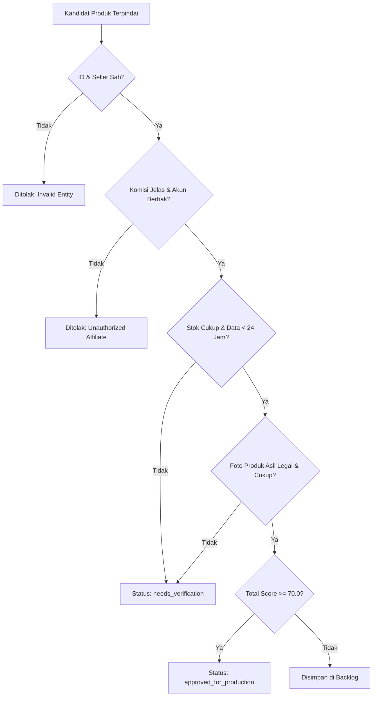

# 04. Product Discovery & Scoring Engine
**Navigasi:** [← 03. Feasibility POCs](./03_feasibility_pocs_and_evaluation_gates.md) | [Index Utama](./README.md) | [Berikutnya: Content Intelligence & Fidelity →](./05_content_intelligence_and_fidelity.md)

---

## 1. Tujuan Mesin Penemuan Produk (*Product Discovery*)

Product Discovery Engine bertugas menemukan kandidat produk fashion di TikTok Shop Indonesia yang memiliki peluang affiliate optimal, memvalidasi kelayakan hukum dan ketersediaannya, serta menyusun daftar prioritas untuk diproduksi menjadi video promosi.

Integrasi didasarkan pada data katalog yang sah (TikTok Shop Affiliate Integration API atau sumber katalog terverifikasi). Sistem menolak keras penggunaan data fiktif atau estimasi tanpa bukti (*hallucinated numbers*).

---

## 2. Struktur Data Produk yang Dikumpulkan

Untuk setiap produk yang dipindai, sistem mengumpulkan atribut data standar:

| Atribut Data | Tipe / Format | Keterangan & Batasan |
|:---|:---|:---|
| `external_product_id` | String | ID unik produk dari TikTok Shop. Digunakan untuk kunci deduplikasi. |
| `product_name` | String | Nama resmi produk dari seller. |
| `category_path` | String | Jalur kategori (misal: *Women's Fashion > Tops > Blouse*). |
| `price_idr` | Numeric | Harga jual aktual dalam mata uang Rupiah (IDR). |
| `seller_id` & `seller_name` | String | Identitas toko/penjual untuk evaluasi reputasi. |
| `commission_rate` | Numeric (0.00–1.00) | Persentase komisi affiliate resmi yang ditetapkan seller (contoh: 0.10 untuk 10%). |
| `commission_amount_est` | Numeric | Estimasi komisi kotor per item terjual ($Price \times Rate$). |
| `rating_star` & `review_count` | Float / Integer | Nilai ulasan (1.0–5.0) dan total jumlah review pembeli riil. |
| `stock_status` | Enum | `in_stock`, `low_stock`, `out_of_stock`. |
| `product_url` | URL | Tautan langsung menuju listing produk. |
| `usable_media_assets` | Array of Objects | Metadata foto resmi seller (`url`, `source_type`, `verified_seller_provided`). |
| `last_synced_at` | Timestamp | Waktu terakhir data disinkronkan dari sumber resmi. |

> [!WARNING]
> **Kebijakan Nol Halusinasi Data:**  
> Jika suatu atribut (misalnya angka penjualan bulanan atau ulasan spesifik) tidak disediakan oleh sumber data resmi, sistem **wajib menandainya sebagai `null` / `unavailable`**. AI dilarang keras mengarang angka penjualan, rating, atau estimasi pembeli untuk menaikkan skor produk.

---

## 3. Formula 6-Dimensi Product Scoring & Normalisasi Matematika

Setiap produk yang lolos seleksi awal dihitung skornya menggunakan formula matematis berbobot baku:

$$\text{Total Score} = \sum_{i=1}^{6} (w_i \times S_i) \quad \text{di mana } w_i \in [0.0, 1.0], \; \sum_{i=1}^{6} w_i = 1.0, \; S_i \in [0, 100]$$

| Dimensi Scoring ($S_i$) | Bobot ($w_i$) | Parameter Evaluasi & Rationale |
|:---|:---:|:---|
| **1. Kecocokan Target Audiens** | $0.20$ | Kesesuaian gaya busana dengan demografi audiens TikTok Indonesia (skor kualitatif Hermes 0–100 berdasarkan tren modest/casual/formal). |
| **2. Potensi Komisi Bersih** | $0.20$ | Normalisasi nominal estimasi komisi bersih terhadap skala 0–100 (lihat rumus normalisasi di bawah). |
| **3. Kualitas Produk & Seller** | $0.20$ | Rating produk ($\ge 4.7$), jumlah ulasan riil, reputasi toko, dan histori pemenuhan pesanan seller. |
| **4. Daya Tarik Konten (*Visual Hook*)** | $0.15$ | Potensi estetika visual produk saat ditampilkan dalam video vertikal (tekstur bahan, keunikan potongan, siluet, warna tren). |
| **5. Harga dan Nilai (*Value for Money*)** | $0.15$ | Keterjangkauan harga bagi pasar lokal (*sweet spot* fashion TikTok Indonesia: Rp 75.000 – Rp 250.000). |
| **6. Ketersediaan & Stabilitas Listing** | $0.10$ | Konsistensi stok seller, varian ukuran lengkap, dan ketiadaan fluktuasi harga drastis. |

### Rumus Normalisasi Dimensi 2 (Potensi Komisi Bersih):
Untuk memetakan nominal rupiah komisi ke dalam skala skor $0 - 100$:

$$S_2 = \text{clamp}\left( \frac{\text{Net Commission Est (IDR)} - \text{Min Threshold}}{\text{Max Target} - \text{Min Threshold}} \times 100, \; 0, \; 100 \right)$$

- $\text{Min Threshold} = \text{Rp } 5.000$ (komisi di bawah Rp 5.000 mendapat $S_2 = 0$).
- $\text{Max Target} = \text{Rp } 50.000$ (komisi $\ge \text{Rp } 50.000$ mendapat $S_2 = 100$).
- Fungsi $\text{clamp}(x, 0, 100)$ memastikan skor berada di batas $[0, 100]$.

### Ambang Kelayakan Numerik Eksplisit:
- **`MIN_APPROVAL_SCORE = 70.0`**: Produk hanya disetujui untuk produksi jika $\text{Total Score} \ge 70.0$.
- Produk dengan skor $50.0 \le \text{Total Score} < 70.0$ disimpan di antrean *backlog*.
- Produk dengan skor $< 50.0$ otomatis ditolak (*rejected*).

---

## 4. Pencatatan Histori Harga & Komisi (`product_price_history`)

Untuk mencegah promosi produk yang harga atau komisinya dinaikkan/diturunkan sepihak oleh seller setelah video diproduksi, sistem mencatat riwayat perubahan harga ke tabel relasional terpisah:
- Setiap kali sinkronisasi katalog mendeteksi perbedaan `price_idr` atau `commission_rate`, baris snapshot baru ditambahkan ke `product_price_history`.
- Hermes membandingkan harga terkini dengan harga saat video dibuat; jika seller memangkas komisi $> 30\%$, promosi produk tersebut otomatis dihentikan sementara.

---

## 5. Gerbang Kelayakan (*Eligibility Gate*)

Sebuah produk hanya dapat dipindahkan dari status `candidate` ke `approved_for_production` jika memenuhi seluruh kriteria gerbang kelayakan:

---

## 6. Kriteria Penerimaan (*Acceptance Criteria*)

- [NOT STARTED - AWAITING POC] **Deduplikasi Mutlak:** Sistem tidak akan membuat entri ganda untuk satu `external_product_id` yang sama.
- [NOT STARTED - AWAITING POC] **Transparansi Keputusan:** Setiap produk yang disetujui atau ditolak memiliki log penalaran yang dapat diaudit dan disimpan bersama nomor versi scoring.
- [NOT STARTED - AWAITING POC] **Pencatatan Historis:** Perubahan harga dan perubahan rate komisi seller tercatat secara historis dalam tabel `product_price_history`.
- [NOT STARTED - AWAITING POC] **Pencegahan Pemborosan:** Produk yang tiba-tiba kehabisan stok (*out of stock*) langsung dinonaktifkan dari antrean produksi brief.

---

**Langkah Selanjutnya:** Pelajari bagaimana produk yang telah disetujui diterjemahkan menjadi skrip dan konsep visual pada [05_content_intelligence_and_fidelity.md](./05_content_intelligence_and_fidelity.md).
