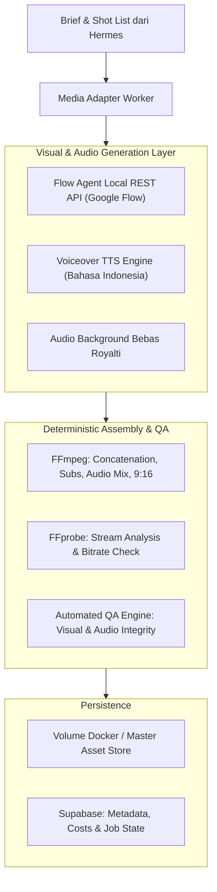

# 06. AI Video Production Engine
**Navigasi:** [← 05. Content Intelligence](./05_content_intelligence_and_fidelity.md) | [Index Utama](./README.md) | [Berikutnya: TikTok Publishing & State Machine →](./07_tiktok_publishing_and_state_machine.md)

---

## 1. Tujuan Mesin Produksi Video AI

AI Video Production Engine bertugas merender video vertikal (*portrait 9:16*) yang konsisten, berestetika tinggi, patuh terhadap fidelitas produk fashion, dan siap dipublikasikan ke TikTok Shop.

Sistem memanfaatkan perpaduan generasi aset visual AI (melalui **Flow Agent** / provider alternatif) dan perakitan teknis deterministik lokal (**FFmpeg Worker**).

---

## 2. Tumpukan Teknologi & Arsitektur Media

- **Hermes Agent:** Mengatur shot list, parameter prompt, batas durasi, dan keputusan retry.
- **Flow Agent:** Menghasilkan klip visual berbasis prompt teks dan referensi gambar produk melalui REST API lokal.
  - *Repo:* [https://github.com/kodelyx/flow-agent](https://github.com/kodelyx/flow-agent)
  - *API Ref:* [https://github.com/kodelyx/flow-agent/blob/main/docs/API_REFERENCE.md](https://github.com/kodelyx/flow-agent/blob/main/docs/API_REFERENCE.md)
- **FFmpeg & FFprobe:** Menggabungkan klip potongan, menyematkan sulih suara (*voice-over*), menambahkan subtitle otomatis dengan *styling* TikTok, dan memastikan format video valid.
- **Supabase & Object Storage:** Menyimpan aset klip, file video final MP4, serta mencatat biaya token/generasi per video.

---

## 3. Alur Produksi Video Bertahap (10 Langkah)

1. **Pemilihan Brief:** Hermes mengambil `content_brief` berstatus `approved` dari Supabase.
2. **Shot List Construction:** Hermes memecah naskah menjadi 3–5 adegan terpisah berdurasi 3–5 detik per adegan.
3. **Asset Gathering & License Check:** Media Worker mengunduh foto produk resmi seller dari storage persisten dan memverifikasi izin hak penggunaannya.
4. **Visual Dispatch (Provider Abstraction):** Media Adapter memanggil API Flow Agent (atau fallback) untuk menghasilkan video setiap adegan dengan rasio 9:16.
5. **Job Monitoring & Lease Heartbeat:** Worker memantau status generasi secara asinkron sambil memperbarui status lease di database Supabase agar tidak dianggap mati.
6. **Voiceover & Audio Synthesis:** Menghasilkan audio pembacaan naskah bahasa Indonesia dengan intonasi natural dan menggabungkannya dengan latar musik (*BGM*).
7. **FFmpeg Assembly:** Merangkai semua klip adegan, menambahkan transisi halus, menempelkan *hardcoded subtitles*, dan normalisasi audio (Loudness EBU R128).
8. **FFprobe Stream Inspection:** Memeriksa integritas metadata file video (resolusi, rasio, bitrate, audio track).
9. **Automated QA Check:** Memverifikasi ketiadaan artefak visual aneh, keterbacaan teks, dan kesesuaian durasi.
10. **Persistence, Cleanup & Notification:** Video final diunggah ke storage persisten, file sementara dibersihkan, metadata serta biaya dicatat di Supabase, dan Hermes diberitahu bahwa video siap untuk *preflight publishing*.

---

## 4. Gerbang Quality Assurance (Technical QA Gate)

Sebelum video dapat masuk ke antrean publikasi, video wajib melewati pemeriksaan teknis otomatis:

| Parameter Uji | Standar Minimum Wajib | Tindakan Jika Gagal |
|:---|:---|:---|
| **Format Kontainer** | MP4 (Video: H.264 / AVC, Audio: AAC) | Re-encode otomatis via FFmpeg |
| **Dimensi & Rasio** | 1080 $\times$ 1920 piksel (Vertikal 9:16 murni) | Re-crop / Scale dengan letterbox aman |
| **Durasi Video** | 15 detik – 35 detik | Reject ke Hermes untuk revisi naskah |
| **Frame Rate** | 30 FPS atau 60 FPS stabil | Normalisasi FPS via FFmpeg |
| **Integritas Audio** | Volume seimbang (-14 s.d. -16 LUFS), tidak ada distorsi | Re-normalize audio track |
| **Watermark & Logo Pihak Ketiga** | Nol watermark asing ilegal (CapCut, logo brand lain) | Reject & generate ulang adegan bersangkutan |
| **Label AI Disclosure** | Metadata mencantumkan tag konten buatan AI (*AI Generated*) | Sematkan tag kepatuhan sebelum posting |

---

## 5. Keandalan Flow Agent: 3-Tier Health Check & Error Handling

Flow Agent tidak boleh diasumsikan sebagai layanan cloud tanpa cela (*always-on enterprise SaaS*). Mengingat cara kerjanya yang memanfaatkan sesi peramban Google Flow:

### Tiga Tingkatan Pemeriksaan Kesehatan (*3-Tier Health Check*):
1. **Tier 1 — `service_health`:** Endpoint HTTP `/health` lokal merespons HTTP 200 (menandakan engine Flow Agent aktif).
2. **Tier 2 — `session_health`:** Memverifikasi bahwa profil Chrome memiliki kuki autentikasi Google Flow yang valid dan tidak teralihkan ke laman login atau challenge 2FA.
3. **Tier 3 — `generation_smoke_test`:** Mengirim prompt uji coba klip mini untuk memastikan layanan upstream Google merespons normal tanpa HTTP 502.

### Penanganan Error Upstream (HTTP 502):
- Dokumentasi Flow Agent mencatat bahwa respon **HTTP 502** menandakan penolakan generasi oleh layanan Google upstream (misalnya karena filter konten prompt, limitasi kuota, atau gangguan sesi).
- Jika terjadi HTTP 502, sistem **tidak langsung melakukan retry berulang-ulang**. Media Adapter menerapkan jeda *cooldown* 3 menit, menganalisis pesan error, dan jika kegagalan berulang lebih dari 2 kali, pekerjaan dialihkan ke **Provider Fallback (Fal.ai / Kling API)** atau dihentikan dengan status `upstream_generation_rejected`.
- **Budget Guard:** Setiap video memiliki batas atas biaya generasi ($Max Cost Threshold$). Jika jumlah retry generasi klip melampaui batas anggaran, job dipindahkan ke status `cost_limit_exceeded` untuk dianalisis oleh Hermes.

---

**Langkah Selanjutnya:** Pelajari bagaimana video yang lolos QA dipublikasikan dan diverifikasi penautan keranjang kuningnya pada [07_tiktok_publishing_and_state_machine.md](./07_tiktok_publishing_and_state_machine.md).
