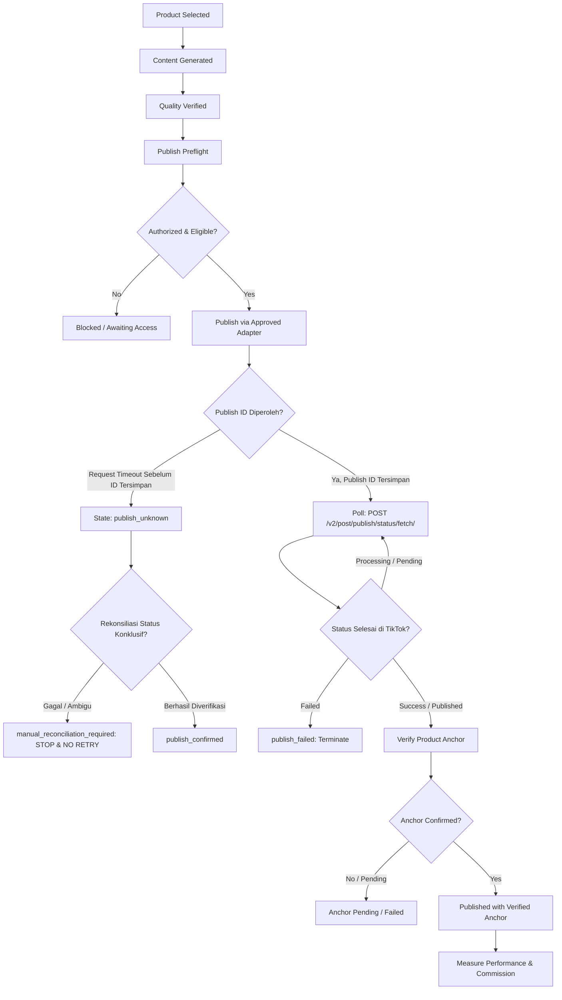

# 07. TikTok Publishing & Publish State Machine
**Navigasi:** [← 06. AI Video Production](./06_ai_video_production_engine.md) | [Index Utama](./README.md) | [Berikutnya: Analytics, Unit Economics & Learning →](./08_analytics_learning_and_unit_economics.md)

---

## 1. Tujuan & Pemisahan Dua Domain Kritis

Publishing Engine bertugas menerbitkan video ke akun TikTok yang diotorisasi dan memastikan keterkaitan produk affiliate benar-benar tervalidasi.

> [!IMPORTANT]
> **Prinsip Arsitektur Fundamental:**  
> **Publishing (Penerbitan Konten)** dan **Anchor Management (Penautan & Verifikasi Keranjang Kuning)** adalah **dua proses terpisah yang tidak boleh disatukan.**  
> Keberhasilan mengunggah video ke TikTok sama sekali bukan bukti bahwa keranjang kuning telah berhasil dipasang.

---

## 2. Status Kesiapan Akun & Realita Regulasi API TikTok

Sebelum operasi penerbitan otomatis diizinkan berjalan, sistem memeriksa daftar periksa (*account readiness*):

- [ ] **Akun Kreator Terdaftar:** Akun TikTok Indonesia telah aktif dan memenuhi syarat program TikTok Shop Creator.
- [ ] **Status Affiliate Aktif:** Akun telah diotorisasi untuk menambahkan tautan komisi ke dalam video.
- [ ] **Aplikasi Developer:** Developer App di portal TikTok for Developers telah disetujui.
- [ ] **Scope Izin Direct Post:** Scope `video.publish` dan/atau `video.upload` telah disetujui.
- [ ] **Audit Kelayakan Aplikasi (*App Review / Audit*):** Sesuai ketentuan TikTok Content Posting API, aplikasi yang belum lolos proses audit resmi dibatasi hanya dapat memposting ke status **Private Viewing (`SELF_ONLY`)**. Karena itu, ketersediaan API tidak otomatis berarti akun baru dapat langsung menerbitkan video publik ke feed FYP.
- [ ] **Kebijakan Larangan Bot Utilitas:** Panduan TikTok Developer melarang aplikasi yang semata-mata menjadi utilitas pengunggah konten ke akun pembuat aplikasi sendiri tanpa UI pratinjau dan persetujuan pengguna.
- [ ] **Akses Shoppable Video API:** Mengevaluasi changelog terbaru *Post Shoppable Video and Photos APIs (v202607)* untuk mengetahui ketersediaan fitur penautan produk via API pada pasar Indonesia.

**Referensi Resmi:**
- [TikTok Content Posting API — Get Started](https://developers.tiktok.com/docs/en/content-posting-api-get-started)
- [TikTok Content Posting API — Direct Post Reference](https://developers.tiktok.com/docs/en/content-posting-api-reference-direct-post)
- [TikTok Content Posting API — Publish Status Fetch](https://developers.tiktok.com/docs/en/content-posting-api-reference-get-publish-status)
- [TikTok Shop — Affiliate Integration](https://partner.tiktokshop.com/docv2/page/affiliate-integration)

---

## 3. Jalur Operasional Utama MVP: Assisted Publishing & Ready-to-Publish Package

Untuk fase MVP, sistem menetapkan **Assisted Publishing** sebagai jalur operasional utama yang pragmatis dan patuh regulasi platform:

```mermaid
flowchart LR
    subgraph Machine ["Velora AI (Hermes AI Operator)"]
        A[Scoring Produk Lolos] --> B[Generate Script & Visual]
        B --> C[Assembly FFmpeg: 9:16 + VO + Subtitle]
        C --> D[Generate Ready-to-Publish Package]
        D --> E[Dispatcher: Kirim ke Telegram / Dashboard]
    end

    subgraph Human ["Assisted Step di TikTok Mobile"]
        E --> F[Terima Paket di HP]
        F --> G[Buka TikTok -> Pilih Video]
        G --> H[Verifikasi 5 Checkpoint Kepatuhan]
        H --> I[Tautkan Keranjang Kuning -> Post]
        I --> J[Input URL Video ke Hermes Feedback Loop]
    end
```

### A. Struktur Ready-to-Publish Package
Setiap konten yang lolos QA teknis dibungkus ke dalam paket data lengkap:
1. **Video Master:** File MP4 vertikal 9:16 (resolusi $\ge 720\text{p}$, bitrate optimal, audio ternormalisasi -14 LUFS, subtitle tersinkron).
2. **Metadata Teks:** Hook caption siap salin, 3–5 hashtag relevan & tren fashion, serta nama resmi produk.
3. **Target Produk Affiliate:** Store Name, Product ID, SKU spesifik, dan estimasi komisi bersih.
4. **Tracking Trace ID:** Identifier unik untuk mengaitkan postingan di feed dengan catatan Supabase.

### B. Lima Checkpoint Kepatuhan Pra-Posting (*Pre-Publish Compliance Checklist*)
Setiap publikasi wajib mematuhi 5 parameter kepatuhan komunitas TikTok:
1. **Commercial Content Disclosure:** Mengaktifkan toggle pengungkapan konten komersial / promosi affiliate di aplikasi resmi TikTok.
2. **AI-Generated Content Label:** Mengaktifkan toggle label konten buatan AI (*AI-generated content*) sesuai kebijakan integritas TikTok.
3. **Product Claim Accuracy:** Memastikan naskah tidak memuat klaim palsu, berlebihan, atau menyesatkan mengenai bahan dan fungsi pakaian.
4. **Asset Usage Rights:** Audio/musik latar menggunakan pustaka resmi (*TikTok Commercial Music Library*) atau voice-over sintetis bebas hak cipta.
5. **Exact Product Match:** Memverifikasi bahwa produk yang disematkan pada keranjang kuning adalah SKU yang persis sama dengan yang dibahas dalam video.

> [!NOTE]
> **Pengukuran Empiris Intervensi Manusia:**  
> Target "30 detik intervensi" diperlakukan sebagai **hipotesis performa**, bukan asumsi mutlak. Sistem akan mencatat waktu riil yang dibutuhkan operator manusia pada 5–10 postingan pertama untuk mengidentifikasi hambatan ergonomi dan menyempurnakan alur paket draf.

---

## 4. Diagram State Machine Penerbitan & Rekonsiliasi Timeout

Seluruh proses penerbitan dikontrol oleh **State Machine Eksplisit** yang menjamin rekonsiliasi status dan mencegah postingan ganda:

---

## 4. Rincian State Mesin & Transisinya

| State Internal | Definisi Status | Aksi Lanjutan oleh Hermes |
|:---|:---|:---|
| `queued` | Video siap masuk antrean jadwal posting. | Menunggu waktu tayang yang dijadwalkan oleh scheduler Hermes. |
| `preflight_failed` | Gagal verifikasi izin (token expired, kuota habis, akun terkena penalti). | Menghentikan alur posting, mengirimkan notifikasi *alert*, tidak mencoba mengunggah. |
| `uploading` | File video sedang ditransfer ke server TikTok. | Memantau respon transfer jaringan. |
| `processing` | Video sedang diproses oleh sistem transcoding TikTok (`publish_id` tersimpan). | Polling status resmi secara berkala. |
| `publish_failed` | Platform menolak video secara eksplisit (alasan hak cipta musik, pelanggaran kebijakan). | Mencatat error code, menandai job sebagai gagal permanen, tidak mengulang. |
| `publish_unknown` | Respon jaringan putus di tengah request sebelum konfirmasi diperoleh. | **Memicu Rekonsiliasi Status Khusus:** Menghentikan postingan baru dan memverifikasi log platform. |
| `manual_reconciliation_required` | Status publikasi tidak dapat dipastikan secara otomatis. | **Kunci Pekerjaan & Dilarang Re-upload:** Menahan job sampai ada pengecekan manual agar video tidak tayang ganda. |
| `published` | Video terkonfirmasi tayang di TikTok, namun keranjang kuning belum dicek. | Memulai sub-alur verifikasi anchor produk. |
| `anchor_pending` | Penautan keranjang kuning sedang diproses sistem TikTok Shop. | Menunggu verifikasi berkala (misal: jeda 5–15 menit). |
| `anchor_failed` | Video tayang namun keranjang kuning gagal terpasang / ditolak platform. | Mencatat anomali, memberi opsi tindak lanjut manual, tidak memasukkan ke metrik sukses anchor. |
| `published_with_verified_anchor` | **Kondisi Sukses Paripurna:** Video terbukti tayang DAN keranjang kuning produk yang benar terbukti aktif. | Mengaktifkan pelacakan analitik dan atribusi komisi secara berkala. |

---

## 5. Koreksi Desain: Penanganan Timeout & Rekonsiliasi Status

> [!CAUTION]
> **Koreksi Kritis: Jangan Gunakan Video List Publik untuk Rekonsiliasi!**  
> Desain awal yang mengandalkan kueri daftar video (`POST /v2/video/list/`) memiliki dua kelemahan fatal:  
> 1. Endpoint tersebut memerlukan scope terpisah `video.list` dan hanya mengembalikan video yang visibilitasnya publik.  
> 2. Konten dari klien Direct Post yang belum diaudit dibatasi ke status privat (`SELF_ONLY`). Artinya, video privat yang berhasil diunggah tidak akan muncul di daftar publik!

### Protokol Rekonsiliasi yang Benar:
1. **Penyimpanan Instan `publish_id`:** Respon inisiasi posting mengembalikan `publish_id`. Nilai ini wajib langsung disimpan ke tabel `publish_queue` sebelum proses streaming video selesai.
2. **Kueri Status Publikasi Resmi:** Pemeriksaan status berkala menggunakan endpoint resmi:
   `POST https://open.tiktokapis.com/v2/post/publish/status/fetch/` dengan payload `{"publish_id": "..."}`.
3. **Kebijakan Anti-Duplikasi (Strict No-Retry):** Jika jaringan putus sebelum `publish_id` tersimpan di database:
   - Sistem **dilarang keras melakukan upload ulang otomatis.**
   - Job dialihkan ke `publish_unknown` $\rightarrow$ `manual_reconciliation_required`.
   - Mengirim notifikasi alert ke pengelola untuk mengecek antrean di aplikasi TikTok.

---

## 6. Posisi TikTok Display API dalam Arsitektur

Dokumentasi resmi TikTok Display API mencakup endpoint:
- `GET /v2/user/info/` — Membaca profil kreator (nama, avatar, open ID). Scope: `user.info.basic`.
- `POST /v2/video/list/` — Mengambil daftar video publik terbaru milik kreator. Scope: `video.list`.
- `POST /v2/video/query/` — Mengambil detail metadata video spesifik berdasarkan `video_ids`.

### Peran Display API dalam AI Affiliate Engine:
1. **Secondary Public Verification:** Setelah video terkonfirmasi terbit via `publish_id`, Display API dipanggil untuk memverifikasi bahwa video telah aktif terindeks di profil publik kreator.
2. **Metadata Sync:** Mengambil `embed_link`, `cover_image_url`, `share_url`, dan `title` resmi dari TikTok untuk disimpan secara persisten di tabel `content_assets` dan `publish_queue`.

### Batasan Mutlak Display API:
- **Bukan API Penerbitan:** Display API adalah antarmuka *read-only*. Ia tidak memiliki kapabilitas untuk mengunggah video atau menautkan keranjang kuning.
- **Hanya Video Publik:** Hanya mengembalikan video berstatus publik (`PUBLIC`). Klien Direct Post yang belum lolos audit menghasilkan video privat (`SELF_ONLY`), sehingga Display API tidak dapat dipakai untuk membuktikan video privat.
- **Tidak Memuat Data Monetisasi:** Respon Display API tidak memuat data klik keranjang kuning, status penautan produk affiliate, nilai GMV, maupun komisi terkonfirmasi.

---

**Langkah Selanjutnya:** Pelajari bagaimana kinerja video dan komisi diukur serta dievaluasi oleh loop pembelajaran pada [08_analytics_learning_and_unit_economics.md](./08_analytics_learning_and_unit_economics.md).
