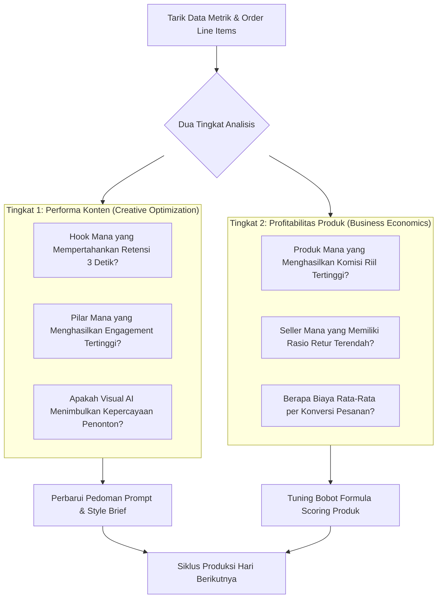

# 08. Analytics, Unit Economics & Autonomous Learning
**Navigasi:** [← 07. TikTok Publishing](./07_tiktok_publishing_and_state_machine.md) | [Index Utama](./README.md) | [Berikutnya: Data Model & Supabase Schema →](./09_data_model_and_supabase_schema.md)

---

## 1. Tujuan Mesin Analitik & Pembelajaran

Affiliate Analytics & Learning Engine bertugas mengukur kualitas performa bisnis secara nyata melalui hasil konten, rasio klik, pesanan tervalidasi, dan komisi bersih yang masuk ke rekening, kemudian **menggunakan temuan tersebut secara otonom untuk memperbaiki strategi pemilihan produk serta naskah pada siklus-siklus berikutnya.**

Prinsip dasar analitik ini adalah **keberpihakan pada laba riil (*Economics-First Analytics*)**, bukan metrik kepuasan semu (*vanity metrics* seperti jutaan views tanpa penjualan).

---

## 2. Metrik Utama: Bisnis vs Konten

Sistem membedakan dua kelompok metrik secara ketat:

### A. Metrik Bisnis & Finansial (*Business Metrics*)
1. **Gross Commission (Estimasi Komisi Kotor):** Nilai komisi yang tercatat saat pembeli melakukan *checkout* sebelum pesanan diselesaikan.
2. **Confirmed Settled Commission (Komisi Bersih Cair):** Dana komisi riil yang cair setelah melewati masa garansi pengembalian barang (*return window*) dan dipotong pembatalan pesanan (*cancellations/refunds*).
3. **Content Production Cost (Biaya Produksi Konten):** Total biaya token model AI, generasi visual Flow Agent, API sulih suara TTS, dan komputasi rendering untuk video terkait.
4. **Platform & Infra Cost (Biaya Infrastruktur):** Alokasi biaya sewa VPS, database Supabase, dan bandwidth storage per video.
5. **Net Operating Profit (Laba Bersih Operasional):** Keuntungan riil setelah seluruh biaya dipotong.
6. **Return on Operating Cost (ROOC):** Rasio efisiensi laba bersih terhadap biaya produksi.

### B. Metrik Konten & Engagement (*Content Metrics*)
1. **Views & Watch Time:** Total penayangan, rata-rata durasi tonton (*average watch time*), dan rasio retensi 3 detik pertama.
2. **Engagement Actions:** Likes, comments, saves, dan share.
3. **Product CTR (Click-Through Rate):** Persentase penonton yang mengeklik keranjang kuning produk (jika data disediakan oleh API).
4. **Conversion Rate (CVR):** Persentase klik keranjang kuning yang berujung pada pesanan.
5. **RPM Komisi (*Commission per 1,000 Views*):** Efisiensi komisi per seribu penayangan video.

> [!NOTE]
> **Penanganan Data Tidak Lengkap:**  
> Jika platform TikTok tidak menyediakan metrik tertentu (misal: completion rate atau click count) pada tingkatan API akun kita, metrik tersebut **wajib diberi status `unavailable`**, bukan diasumsikan nol ($0$), agar tidak mendistorsi algoritma evaluasi AI.

---

## 3. Rumus Laba Bersih Operasional & Multi-Line Orders

Sistem tidak mengizinkan klaim keuntungan hanya berdasarkan perkalian tarif komisi dengan estimasi nilai barang (*GMV*). Satu pesanan (*Order*) dapat terdiri dari beberapa item produk berbeda (*Order Line Items*).

### Rumus Laba Bersih Operasional:
$$\text{Confirmed Net Commission} = \sum_{\text{lines}} (\text{Commission Settled IDR} - \text{Refunds/Cancellations IDR})$$

$$\text{Operating Profit} = \text{Confirmed Net Commission} - \text{Production Costs} - \text{Operational Infra Costs}$$

$$\text{ROOC} = \frac{\text{Operating Profit}}{\text{Production Costs} + \text{Operational Infra Costs}} \times 100\%$$

Contoh Unit Economics per Video:
- **Biaya Produksi 1 Video:**
  - Flow Agent / Visual API: Rp 3.500
  - TTS Voiceover: Rp 500
  - Alokasi VPS & Storage: Rp 1.000
  - *Total Biaya Produksi:* **Rp 5.000**
- **Hasil Kinerja Video (14 Hari):**
  - Views: 15.000 tayangan
  - Pesanan Masuk (Gross Orders): 8 barang
  - Pembatalan / Retur: 1 barang
  - Pesanan Selesai (Confirmed): 7 barang
  - Rata-rata Komisi per Barang: Rp 12.000
  - *Confirmed Net Commission:* $7 \times \text{Rp } 12.000 = \text{Rp } 84.000$
- **Laba Operasional Bersih:**
  $$\text{Rp } 84.000 - \text{Rp } 5.000 = \mathbf{Rp\ 79.000} \quad (\text{ROOC} = +1.580\%)$$

Jika suatu produk atau jenis format video secara konsisten menghasilkan ROOC negatif dalam 5 video berturut-turut, sistem **secara otomatis memasukkan kategori/produk tersebut ke dalam daftar moratorium (penghentian sementara).**

---

## 4. Dua Tingkat Pembelajaran Otonom (*Two-Tier Learning Loop*)

Setiap 24 jam sekali pada akhir siklus harian, Hermes mengeksekusi skill `performance-analytics` untuk mengevaluasi data pada dua tingkatan:

---

## 5. Eksperimentasi Terkendali (*Controlled Experimentation*)

Hermes dilarang melakukan perombakan drastis pada parameter bisnis hanya berdasarkan data dari sedikit video (*avoid overfitting on small sample size*).

- Setiap perubahan formula scoring disimpan dengan nomor versi baru (misal: `v1.0.0` $\rightarrow$ `v1.1.0`) pada tabel `experiments`.
- Sistem mendukung pengujian A/B sederhana: 50% video menggunakan formula scoring lama, 50% menggunakan formula scoring baru untuk menguji peningkatan ROOC secara valid.

---

**Langkah Selanjutnya:** Telusuri skema basis data kanonis yang mendasari seluruh operasional ini pada [09_data_model_and_supabase_schema.md](./09_data_model_and_supabase_schema.md).
