# 09. Data Model & Supabase Schema
**Navigasi:** [← 08. Analytics & Learning](./08_analytics_learning_and_unit_economics.md) | [Index Utama](./README.md) | [Berikutnya: Operasional, Keamanan & Roadmap →](./10_infrastructure_reliability_and_security.md)

---

## 1. Prinsip Desain Basis Data Kanonis

Seluruh *state* persisten sistem disimpan dalam **Supabase (PostgreSQL 15+)**.
1. **Integritas Relasional Mutlak:** Setiap hubungan antartabel ditegakkan melalui *foreign keys* (FK) yang valid dan indeks terarah.
2. **Audit & Jejak Waktu Otomatis:** Setiap tabel memiliki kolom `created_at` dan `updated_at` yang diatur otomatis melalui trigger fungsi `moddatetime` PostgreSQL.
3. **Konkurensi & Penguncian Atomik:** Tabel antrean (`production_jobs` dan `publish_queue`) memiliki kolom *lease lock* untuk mencegah *race condition* antar-worker.
4. **Keamanan Kredensial:** Token OAuth dienkripsi menggunakan standar **AES-256-GCM** di lapisan aplikasi sebelum disimpan ke database, dan tabel dilindungi oleh Row Level Security (RLS).

---

## 2. Diagram Relasi Entitas Kanonis (ERD 15 Tabel)

```mermaid
erDiagram
    affiliate_accounts ||--o{ affiliate_products : discovers
    affiliate_accounts ||--o{ publish_queue : publishes
    affiliate_accounts ||--o{ affiliate_orders : receives
    affiliate_products ||--o{ product_price_history : tracks
    affiliate_products ||--o{ product_scores : evaluated_by
    affiliate_products ||--o{ content_briefs : referenced_in
    experiments ||--o{ product_scores : benchmarks
    content_briefs ||--o{ production_jobs : triggers
    production_jobs ||--o{ content_assets : produces
    production_jobs ||--o{ publish_queue : enqueued_as
    production_jobs ||--o{ cost_events : incurs
    publish_queue ||--o{ affiliate_anchors : links
    publish_queue ||--o{ post_metrics_daily : reports
    publish_queue ||--o{ affiliate_orders : attributes
    affiliate_orders ||--o{ order_line_items : contains
```

---

## 3. Definisi 15 Tabel Kanonis Supabase

### 1. `affiliate_accounts`
Menyimpan akun kreator TikTok dan pemisahan dua konteks token OAuth.
- `id` (UUID, PK, DEFAULT gen_random_uuid())
- `tiktok_open_id` (TEXT, UNIQUE, NOT NULL)
- `handle_name` (TEXT, NOT NULL)
- `auth_status` (ENUM: `active`, `expired`, `suspended`, `revoked`)
- `content_posting_token_enc` (TEXT) *(Token Content Posting API, AES-256-GCM)*
- `content_posting_refresh_enc` (TEXT)
- `content_posting_expires_at` (TIMESTAMPTZ)
- `shop_partner_token_enc` (TEXT) *(Token TikTok Shop Partner API, AES-256-GCM)*
- `shop_partner_refresh_enc` (TEXT)
- `shop_partner_expires_at` (TIMESTAMPTZ)
- `app_audit_status` (ENUM: `development_private`, `audited_public`)
- `created_at` / `updated_at` (TIMESTAMPTZ, NOT NULL)

---

### 2. `affiliate_products`
Katalog master produk fashion yang dipindai dari TikTok Shop Indonesia.
- `id` (UUID, PK, DEFAULT gen_random_uuid())
- `discovered_by_account_id` (UUID, FK $\rightarrow$ `affiliate_accounts.id`, NOT NULL)
- `external_product_id` (TEXT, UNIQUE, NOT NULL)
- `title` (TEXT, NOT NULL)
- `category_path` (TEXT, NOT NULL)
- `price_idr` (NUMERIC(15,2), NOT NULL)
- `seller_id` (TEXT, NOT NULL)
- `seller_name` (TEXT, NOT NULL)
- `commission_rate` (NUMERIC(5,4), NOT NULL)
- `stock_status` (ENUM: `in_stock`, `low_stock`, `out_of_stock`)
- `rating_star` (NUMERIC(3,2))
- `review_count` (INT, DEFAULT 0)
- `product_url` (TEXT, NOT NULL)
- `raw_media_urls` (JSONB, NOT NULL)
- `lifecycle_status` (ENUM: `candidate`, `needs_verification`, `approved`, `rejected`, `deprecated`)
- `created_at` / `updated_at` (TIMESTAMPTZ, NOT NULL)

---

### 3. `product_price_history`
Mencatat perubahan harga jual, komisi, dan stok seller secara historis.
- `id` (UUID, PK, DEFAULT gen_random_uuid())
- `product_id` (UUID, FK $\rightarrow$ `affiliate_products.id` ON DELETE CASCADE, NOT NULL)
- `price_idr` (NUMERIC(15,2), NOT NULL)
- `commission_rate` (NUMERIC(5,4), NOT NULL)
- `stock_status` (TEXT, NOT NULL)
- `recorded_at` (TIMESTAMPTZ, NOT NULL, DEFAULT NOW())
- `created_at` / `updated_at` (TIMESTAMPTZ, NOT NULL)

---

### 4. `experiments`
Catatan hipotesis strategi, pengujian A/B scoring, dan hasil evaluasi.
- `id` (UUID, PK, DEFAULT gen_random_uuid())
- `hypothesis_title` (TEXT, NOT NULL)
- `strategy_type` (TEXT, NOT NULL)
- `scoring_weights_json` (JSONB, NOT NULL)
- `status` (ENUM: `active`, `concluded`, `abandoned`)
- `evaluation_summary` (TEXT)
- `rooc_result` (NUMERIC(8,4))
- `created_at` / `updated_at` (TIMESTAMPTZ, NOT NULL)

---

### 5. `product_scores`
Hasil perhitungan scoring 6-dimensi produk beserta penalarannya.
- `id` (UUID, PK, DEFAULT gen_random_uuid())
- `product_id` (UUID, FK $\rightarrow$ `affiliate_products.id` ON DELETE CASCADE, NOT NULL)
- `experiment_id` (UUID, FK $\rightarrow$ `experiments.id`, NULLABLE)
- `scoring_version` (TEXT, NOT NULL)
- `total_score` (NUMERIC(5,2), NOT NULL)
- `score_breakdown` (JSONB, NOT NULL)
- `ai_reasoning` (TEXT, NOT NULL)
- `confidence_score` (NUMERIC(3,2), NOT NULL)
- `created_at` / `updated_at` (TIMESTAMPTZ, NOT NULL)

---

### 6. `content_briefs`
Perencanaan konsep konten, naskah, sudut pandang, dan shot list.
- `id` (UUID, PK, DEFAULT gen_random_uuid())
- `product_id` (UUID, FK $\rightarrow$ `affiliate_products.id` ON DELETE CASCADE, NOT NULL)
- `content_pillar` (ENUM: `outfit_formula`, `detail_comparison`, `outfit_by_budget`, `one_item_three_looks`)
- `hook_text` (TEXT, NOT NULL)
- `script_text` (TEXT, NOT NULL)
- `scene_breakdown` (JSONB, NOT NULL)
- `cta_text` (TEXT, NOT NULL)
- `caption` (TEXT, NOT NULL)
- `hashtags` (TEXT[], NOT NULL)
- `fingerprint_hash` (TEXT, UNIQUE, NOT NULL)
- `status` (ENUM: `draft`, `approved`, `produced`, `discarded`)
- `created_at` / `updated_at` (TIMESTAMPTZ, NOT NULL)

---

### 7. `production_jobs`
Status pekerjaan render video asinkron, retry, dan lease worker atomik.
- `id` (UUID, PK, DEFAULT gen_random_uuid())
- `brief_id` (UUID, FK $\rightarrow$ `content_briefs.id` ON DELETE CASCADE, NOT NULL)
- `provider_used` (TEXT, NOT NULL, DEFAULT 'flow_agent')
- `provider_job_id` (TEXT)
- `idempotency_key` (TEXT, UNIQUE, NOT NULL)
- `job_status` (ENUM: `queued`, `claimed`, `generating_visuals`, `assembling_ffmpeg`, `qa_running`, `completed`, `failed`, `dead_letter`)
- `locked_by` (TEXT) *(Worker instance ID)*
- `locked_at` (TIMESTAMPTZ)
- `lease_expires_at` (TIMESTAMPTZ)
- `retry_count` (INT, DEFAULT 0, NOT NULL)
- `error_message` (TEXT)
- `qa_report` (JSONB)
- `created_at` / `updated_at` (TIMESTAMPTZ, NOT NULL)

---

### 8. `content_assets`
Aset digital yang digunakan dan dihasilkan selama proses produksi.
- `id` (UUID, PK, DEFAULT gen_random_uuid())
- `job_id` (UUID, FK $\rightarrow$ `production_jobs.id` ON DELETE CASCADE, NOT NULL)
- `asset_type` (ENUM: `source_image`, `generated_clip`, `voiceover_audio`, `final_video_mp4`, `thumbnail`)
- `storage_path` (TEXT, NOT NULL)
- `license_source` (TEXT)
- `license_verified` (BOOLEAN, DEFAULT FALSE)
- `duration_seconds` (NUMERIC(5,2))
- `file_size_bytes` (BIGINT)
- `created_at` / `updated_at` (TIMESTAMPTZ, NOT NULL)

---

### 9. `publish_queue`
Antrean jadwal publikasi video dan status penerbitan platform.
- `id` (UUID, PK, DEFAULT gen_random_uuid())
- `account_id` (UUID, FK $\rightarrow$ `affiliate_accounts.id`, NOT NULL)
- `job_id` (UUID, FK $\rightarrow$ `production_jobs.id`, NOT NULL)
- `video_asset_id` (UUID, FK $\rightarrow` `content_assets.id`, NOT NULL)
- `idempotency_key` (TEXT, UNIQUE, NOT NULL)
- `publish_status` (ENUM: `queued`, `preflight_failed`, `uploading`, `processing`, `published`, `publish_failed`, `publish_unknown`, `manual_reconciliation_required`, `published_with_verified_anchor`)
- `tiktok_publish_id` (TEXT)
- `tiktok_item_id` (TEXT)
- `scheduled_at` (TIMESTAMPTZ, NOT NULL)
- `published_at` (TIMESTAMPTZ)
- `created_at` / `updated_at` (TIMESTAMPTZ, NOT NULL)

---

### 10. `affiliate_anchors`
Pencatatan status keterkaitan keranjang kuning produk pada postingan.
- `id` (UUID, PK, DEFAULT gen_random_uuid())
- `publish_queue_id` (UUID, FK $\rightarrow$ `publish_queue.id` ON DELETE CASCADE, NOT NULL)
- `product_id` (UUID, FK $\rightarrow$ `affiliate_products.id`, NOT NULL)
- `anchor_status` (ENUM: `not_checked`, `anchor_pending`, `anchor_verified`, `anchor_failed`, `manual_verification_required`)
- `verification_method` (ENUM: `official_api`, `ui_check`, `manual_audit`)
- `evidence_payload` (JSONB)
- `verified_at` (TIMESTAMPTZ)
- `created_at` / `updated_at` (TIMESTAMPTZ, NOT NULL)

---

### 11. `post_metrics_daily`
Metrik harian performa konten video.
- `id` (UUID, PK, DEFAULT gen_random_uuid())
- `publish_queue_id` (UUID, FK $\rightarrow$ `publish_queue.id` ON DELETE CASCADE, NOT NULL)
- `record_date` (DATE, NOT NULL)
- `views` (INT, DEFAULT 0, NOT NULL)
- `likes` (INT, DEFAULT 0, NOT NULL)
- `comments` (INT, DEFAULT 0, NOT NULL)
- `shares` (INT, DEFAULT 0, NOT NULL)
- `avg_watch_time_seconds` (NUMERIC(5,2))
- `product_clicks` (INT) *(NULL jika unavailable)*
- `created_at` / `updated_at` (TIMESTAMPTZ, NOT NULL)

---

### 12. `affiliate_orders`
Master transaksi pesanan yang diatribusikan ke akun kita.
- `id` (UUID, PK, DEFAULT gen_random_uuid())
- `account_id` (UUID, FK $\rightarrow$ `affiliate_accounts.id`, NOT NULL)
- `publish_queue_id` (UUID, FK $\rightarrow$ `publish_queue.id`, NULLABLE)
- `external_order_id` (TEXT, UNIQUE, NOT NULL)
- `order_status` (ENUM: `pending`, `confirmed`, `settled`, `cancelled`, `refunded`)
- `total_order_amount_idr` (NUMERIC(15,2), NOT NULL)
- `total_commission_estimated_idr` (NUMERIC(15,2), NOT NULL)
- `total_commission_settled_idr` (NUMERIC(15,2), DEFAULT 0)
- `settled_at` (TIMESTAMPTZ)
- `created_at` / `updated_at` (TIMESTAMPTZ, NOT NULL)

---

### 13. `order_line_items`
Rincian per item dalam satu pesanan affiliate.
- `id` (UUID, PK, DEFAULT gen_random_uuid())
- `order_id` (UUID, FK $\rightarrow$ `affiliate_orders.id` ON DELETE CASCADE, NOT NULL)
- `product_id` (UUID, FK $\rightarrow$ `affiliate_products.id`, NOT NULL)
- `external_item_id` (TEXT)
- `quantity` (INT, NOT NULL, DEFAULT 1)
- `line_amount_idr` (NUMERIC(15,2), NOT NULL)
- `commission_rate` (NUMERIC(5,4), NOT NULL)
- `commission_estimated_idr` (NUMERIC(15,2), NOT NULL)
- `commission_settled_idr` (NUMERIC(15,2), DEFAULT 0)
- `is_refunded` (BOOLEAN, DEFAULT FALSE)
- `created_at` / `updated_at` (TIMESTAMPTZ, NOT NULL)

---

### 14. `cost_events`
Rincian biaya operasional riil per pekerjaan (token AI, render, infra).
- `id` (UUID, PK, DEFAULT gen_random_uuid())
- `job_id` (UUID, FK $\rightarrow$ `production_jobs.id`, NULLABLE)
- `cost_type` (ENUM: `visual_gen`, `tts_audio`, `infra_compute`, `api_call`)
- `amount_idr` (NUMERIC(15,2), NOT NULL)
- `metadata` (JSONB)
- `created_at` / `updated_at` (TIMESTAMPTZ, NOT NULL)

---

### 15. `workflow_events`
Audit log menyeluruh mencatat semua transisi pekerjaan dan error.
- `id` (UUID, PK, DEFAULT gen_random_uuid())
- `entity_type` (TEXT, NOT NULL)
- `entity_id` (UUID, NOT NULL)
- `event_name` (TEXT, NOT NULL)
- `payload` (JSONB)
- `created_at` (TIMESTAMPTZ, NOT NULL, DEFAULT NOW())

---

**Langkah Selanjutnya:** Pahami spesifikasi operasional infrastruktur, manajemen risiko, dan roadmap pada [10_infrastructure_reliability_and_security.md](./10_infrastructure_reliability_and_security.md).
