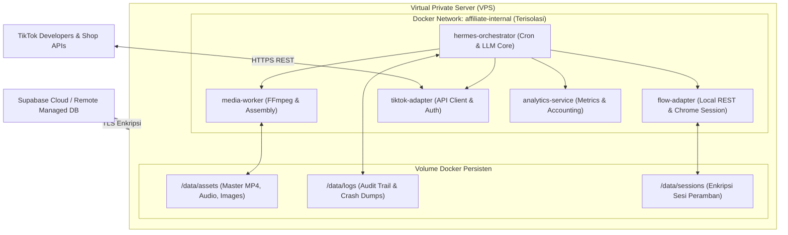

# 10. Operasional, Keamanan & Roadmap Eksekusi
**Navigasi:** [← 09. Data Model & Schema](./09_data_model_and_supabase_schema.md) | [Index Utama](./README.md)

---

## 1. Topologi Infrastruktur VPS & Docker Compose

Seluruh arsitektur sistem dikemas ke dalam kontainer Docker pada 1 unit VPS Ubuntu LTS (dengan pengujian awal pada mesin lokal Windows):



- **Isolasi Jaringan:** Layanan pendukung (FFmpeg worker, Flow adapter, TikTok adapter) berada di jaringan internal Docker tanpa port yang diekspos ke publik internet (*no public listening ports*).
- **Volume Mounts:** File master video, aset gambar, dan log disimpan dalam volume persisten di host agar tidak hilang saat kontainer direstart.

---

## 2. Ketahanan Operasional (*Operational Reliability*)

Sistem dirancang untuk tangguh menghadapi kegagalan tak terduga:

| Kondisi Kegagalan | Mekanisme Pemulihan Otomatis |
|:---|:---|
| **Hermes Container Restart** | State dibaca ulang dari Supabase (`production_jobs` berstatus `queued` atau `claimed`). Pekerjaan dilanjutkan tanpa memicu job duplikat. |
| **Sesi Google Flow Kedaluwarsa** | 3-Tier Health check menandai status `session_expired`, memicu notifikasi peringatan (*Telegram/Webhook alert*), dan menahan produksi baru. |
| **Upstream Flow Agent Timeout / HTTP 502** | Cooldown 3 menit, retry maksimal 2 kali, lalu dialihkan otomatis ke Provider Fallback (Fal.ai / Kling API) atau status gagal terkontrol. |
| **Token TikTok OAuth Kedaluwarsa** | Refresh token otomatis dijalankan sebelum request posting. Jika refresh gagal, job ditandai `preflight_failed` untuk re-autentikasi manual. |
| **Request Posting Mengalami Timeout** | **DILARANG RE-UPLOAD OTOMATIS!** Sistem memicu rekonsiliasi status (`manual_reconciliation_required`) via kueri status `publish_id` sebelum mengambil tindakan baru. |
| **Pekerjaan Gagal Berulang Kali** | Setelah batas 3x retry habis, job dipindahkan ke status **Dead-Letter State** (`dead_letter`) agar tidak membebani antrean. |
| **Lonjakan Biaya Token AI** | **Budget Guard:** Jika akumulasi biaya harian melebihi batas yang ditentukan (misal: Rp 50.000/hari), siklus otomatis di-pause. |

---

## 3. Keamanan, Enkripsi Kredensial & Kepatuhan Platform

### A. Manajemen Enkripsi Token & Kunci Rahasia
1. **Application-Level Enkripsi (AES-256-GCM):** Token OAuth TikTok dan sesi kredensial dienkripsi pada layer aplikasi menggunakan symmetric key (`APP_MASTER_ENCRYPTION_KEY`) yang dimuat secara aman dari environment variable VPS. Kolom database hanya menyimpan cipher text dan initialization vector (IV).
2. **Rotasi Kunci:** Sistem menyediakan utilitas rotasi kunci berkala untuk memperbarui enkripsi tanpa memutus sesi aktif.
3. **Pemisahan Kredensial:** Secret TikTok for Developers dan TikTok Shop Partner dipisahkan dalam vault konfigurasi yang berbeda.

### B. Kepatuhan Ketentuan Platform TikTok
1. **Transparansi AI:** Seluruh video yang diunggah menyertakan metadata label pengungkapan konten buatan AI (*AI Generated Content disclosure*).
2. **Kepatuhan Terhadap Larangan Bot:** Sistem tidak menggunakan teknik bypass yang melanggar ketentuan TikTok. Jika API Direct Post mewajibkan konfirmasi kreator, sistem mengoperasikan mode *Assisted/Draft Publishing*.

---

## 4. Milestone Implementasi Berdasarkan Dependensi POC

Roadmap diatur secara berurutan (*strictly sequential*); Fase 2 hanya dapat dimulai setelah seluruh gerbang pengujian POC Fase 1 dinyatakan lulus (*PASS*):

```mermaid
gantt
    title Roadmap Implementasi AI Fashion Affiliate Engine (Gate-Driven)
    dateFormat  YYYY-MM-DD
    section Fase 1: Validasi POCs (Gerbang Mutlak)
    POC 1: Audit Akun & Jalur TikTok ID       :2026-10-10, 4d
    POC 2: Publish & Shoppable Anchor PoC     :2026-10-14, 4d
    POC 3: Flow Agent 3-Tier Health Check     :2026-10-18, 3d
    POC 4: Hermes State & Recovery PoC        :2026-10-21, 3d
    section Fase 2: Mesin Konten & Scoring
    Catalog Discovery & 6D Scoring Engine     :2026-10-24, 4d
    Content Brief & Sanitized Scriptwriting   :2026-10-28, 3d
    Media Adapter & FFmpeg Worker             :2026-10-31, 4d
    section Fase 3: Integrasi & Closed Loop
    Publishing Adapter & State Machine        :2026-11-04, 4d
    Anchor Verification & Order Tracking      :2026-11-08, 3d
    Analytics, Accounting & Feedback Loop     :2026-11-11, 4d
    End-to-End Pilot 1 Akun                   :2026-11-15, 7d
```

---

## 5. Kriteria Penerimaan MVP (*Acceptance Criteria*)

Sistem MVP dinyatakan siap uji operasi jika memenuhi kriteria mutlak:
- [NOT STARTED - AWAITING POC] Hermes menjalankan seluruh siklus kerja secara mandiri tanpa bantuan n8n.
- [NOT STARTED - AWAITING POC] Produk dipilih berdasarkan scoring transparan (skor $\ge 70.0$) dan data katalog sah.
- [NOT STARTED - AWAITING POC] Video 9:16 diproduksi oleh Flow Agent dan FFmpeg dengan fidelitas produk yang teruji.
- [NOT STARTED - AWAITING POC] Status video dan status penautan keranjang kuning diverifikasi secara terpisah.
- [NOT STARTED - AWAITING POC] State pekerjaan dapat dipulihkan secara aman setelah server direstart (*crash-proof*).
- [NOT STARTED - AWAITING POC] Tidak ada video duplikat yang tercipta akibat request timeout (mekanisme anti-re-upload aktif).
- [NOT STARTED - AWAITING POC] Biaya produksi per video dan komisi bersih tercatat di Supabase untuk menghitung laba operasional riil.

---

## 6. Matriks Risiko & Rencana Mitigasi

| Potensi Risiko | Tingkat Dampak | Strategi Mitigasi Terencana |
|:---|:---:|:---|
| **Direct Post Ditolak untuk Private Bot** | Kritis | Terapkan alur resmi *Assisted/Draft Publishing* (Hermes memproduksi dan menyiapkan draft; kreator 1-klik konfirmasi penautan di aplikasi). |
| **Shoppable Video API Butuh Izin Partner Khusus** | Tinggi | Ajukan verifikasi ke TikTok Shop Partner Center; gunakan alur draft terstruktur selama proses audit berjalan. |
| **Sesi Google Flow Tiba-Tiba Logout di VPS** | Tinggi | 3-Tier health check mendeteksi sesi putus sebelum render dimulai; sistem beralih ke Fallback API (Fal.ai/Kling) atau jeda otomatis. |
| **AI Mengubah Karakteristik Pakaian** | Tinggi | Wajibkan penggunaan foto produk asli seller sebagai referensi gambar (*image conditioning*) dan jalankan Fact-Check QA. |
| **Views Tinggi Namun Komisi Nol** | Sedang | Perbaiki hook dan penawaran naskah; utamakan produk dengan harga terjangkau (*sweet spot*) dan rating tinggi. |

---

## 7. Definition of Done (DoD)

Sebuah modul atau fitur dianggap **Selesai (*Done*)** hanya jika:
1. Kode sumber dan konfigurasi telah di-*commit* ke repositori Git.
2. Fitur telah diuji perilakunya pada lingkungan pengujian nyata (lokal / VPS).
3. Seluruh skema data dan migrasi tersimpan secara persisten di Supabase dengan foreign key lengkap.
4. Error handling, mekanisme retry, dan pencatatan audit log telah diverifikasi.
5. Fitur tidak melanggar batasan platform dan tidak membocorkan kredensial.
6. Tidak ada fitur yang dinyatakan selesai hanya berdasarkan simulasi fiktif (*mock data*) jika acceptance criteria mensyaratkan bukti platform nyata.

---

## 8. Keputusan Arsitektur Final

> **Ringkasan Komitmen Teknis:**  
> 1. Hermes Agent adalah satu-satunya orchestrator cerdas (tanpa n8n).  
> 2. Supabase adalah sumber kebenaran tunggal untuk semua status operasional dengan 15 tabel kanonis.  
> 3. Arsitektur Adapter memisahkan logika bisnis dari implementasi teknis eksternal.  
> 4. Validasi izin platform TikTok Shop Indonesia dan penautan shoppable anchor adalah prioritas eksperimen pertama sebelum skalasi produksi.  
> 5. Keberhasilan diukur dari **laba bersih komisi riil (*net operating profit*)**, bukan sekadar banyaknya video yang tayang.
