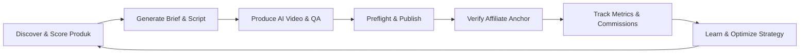

# AI Fashion Affiliate Engine — PRD Master Index
**Platform:** TikTok Shop Indonesia | **Kategori:** Data-Driven Fashion Affiliate | **Orchestrator:** Hermes Agent  
**Status Dokumen:** `AUDITED & HARMONIZED (READY FOR POC REVIEW)` | **Versi:** 1.1

---

## Ringkasan Proyek

**AI Fashion Affiliate Engine** adalah sistem otomatis berbasis AI yang mengoperasikan siklus bisnis TikTok Shop Affiliate di pasar Indonesia secara mandiri dan *data-driven*. Sistem ini mencakup riset produk fashion berbasis data katalog sah, scoring multidimensi, perumusan strategi konten, produksi video AI vertikal (*faceless* 9:16) berfidelitas tinggi terhadap produk fisik, verifikasi teknis & kepatuhan, penerbitan konten terotorisasi, verifikasi penautan keranjang kuning (*affiliate anchor*), serta evaluasi metrik konversi dan komisi bersih.

Sistem dirancang dengan arsitektur **Hermes-native (tanpa n8n)**, memanfaatkan **MCP (Model Context Protocol)** sebagai lapisan antarmuka tool standar, **Supabase (PostgreSQL 15+)** sebagai *single source of truth* persisten, serta **Adapter Pattern** modular untuk memisahkan logika bisnis dari implementasi teknis platform pihak ketiga.

---

## Struktur Dokumentasi PRD Modular

Dokumentasi Product Requirements Document (PRD) ini dipecah menjadi 10 modul spesifik yang saling terhubung menggunakan tautan Markdown relatif:

| No | Modul PRD | Deskripsi Utama | File Dokumen |
|:---|:---|:---|:---|
| 01 | **Visi, Masalah & Target Pengguna** | Latar belakang, problem statement, visi autonomous affiliate, profil target pengguna, dan klasifikasi level otomatisasi (Level 1 Autonomous Ops vs Level 2 Unattended Platform Actions). | [01_executive_summary_and_vision.md](./01_executive_summary_and_vision.md) |
| 02 | **Arsitektur Sistem & Orkestrasi Hermes** | Peran Hermes sebagai pusat *reasoning* & cron scheduler, ketiadaan n8n, pola Adapter, peran MCP wrapper, dual-context OAuth, dan atomic worker lease lock. | [02_architecture_and_hermes_orchestration.md](./02_architecture_and_hermes_orchestration.md) |
| 03 | **Feasibility POCs & Platform Evaluation Gates** | 4 Eksperimen teknis wajib sebelum pembangunan skala penuh (Validasi TikTok Shop ID, Shoppable Video API, Flow Agent VPS 3-tier health check, Learning Loop), dan evaluasi API vs Playwright. | [03_feasibility_pocs_and_evaluation_gates.md](./03_feasibility_pocs_and_evaluation_gates.md) |
| 04 | **Product Discovery & Scoring Engine** | Kurasi katalog affiliate, formula matematis 6 dimensi scoring, min-max normalisasi komisi, threshold numerik kelayakan, deduplikasi, dan histori harga/komisi. | [04_product_discovery_and_scoring.md](./04_product_discovery_and_scoring.md) |
| 05 | **Content Intelligence & Product Fidelity** | 4 pilar format fashion, skema brief terstruktur, pemisahan exact deduplication vs fuzzy similarity, aturan fidelitas fisik produk (anti-halusinasi visual), dan lisensi aset. | [05_content_intelligence_and_fidelity.md](./05_content_intelligence_and_fidelity.md) |
| 06 | **AI Video Production Engine** | Integrasi Flow Agent, 3-tier health check (service, session, smoke test), Media Adapter provider-agnostic, pipeline FFmpeg/FFprobe, dan automated QA teknis & visual. | [06_ai_video_production_engine.md](./06_ai_video_production_engine.md) |
| 07 | **TikTok Publishing & State Machine** | Diagram State Machine penerbitan, rekonsiliasi kegagalan via `publish_id`, penanganan visibilitas `SELF_ONLY`, pencegahan re-upload ganda, dan evaluasi Shoppable Video API v202607. | [07_tiktok_publishing_and_state_machine.md](./07_tiktok_publishing_and_state_machine.md) |
| 08 | **Analytics, Unit Economics & Autonomous Learning** | Rumus net commission & operating profit, rincian *order line items*, pelacakan metrik views vs GMV, dan loop optimasi strategi otomatis Hermes berbasis ROOC. | [08_analytics_learning_and_unit_economics.md](./08_analytics_learning_and_unit_economics.md) |
| 09 | **Data Model & Supabase Schema** | Desain kanonis 15 tabel relasional, PostgreSQL enum, foreign keys terintegrasi, snapshot harga, order lines, audit trail, Row Level Security (RLS), dan enkripsi AES-256 kredensial. | [09_data_model_and_supabase_schema.md](./09_data_model_and_supabase_schema.md) |
| 10 | **Operasional, Keamanan & Roadmap Eksekusi** | Topologi VPS Docker, manajemen rahasia, dead-letter state, budget guard, KPI, risiko & mitigasi, roadmap berurutan sesuai gate POC, dan Definition of Done. | [10_infrastructure_reliability_and_security.md](./10_infrastructure_reliability_and_security.md) |
| 📄 | **Master Monolith PRD** | Versi lengkap satu berkas terpadu yang memuat seluruh spesifikasi teknis untuk keperluan audit menyeluruh atau ekspor dokumen. | [PRD.md](./PRD.md) |

---

## Siklus Operasional Utama (*Autonomous Loop*)

Setiap siklus dijalankan secara deterministik oleh **Hermes Agent** memanfaatkan tools yang terisolasi dalam Adapter, mencatat seluruh state transaksional ke dalam **Supabase**, dan tidak pernah mengasumsikan keberhasilan tanpa bukti (*evidence-based execution*).
